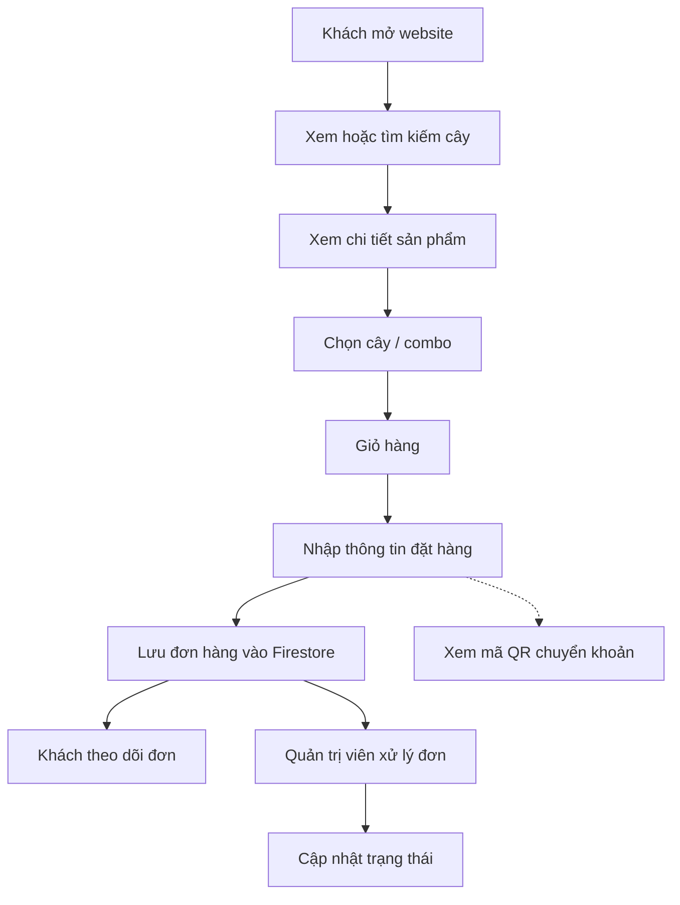
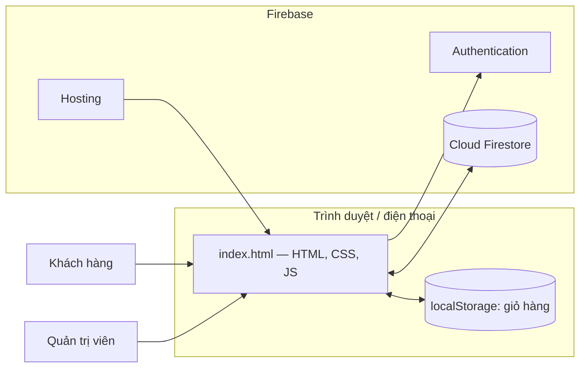
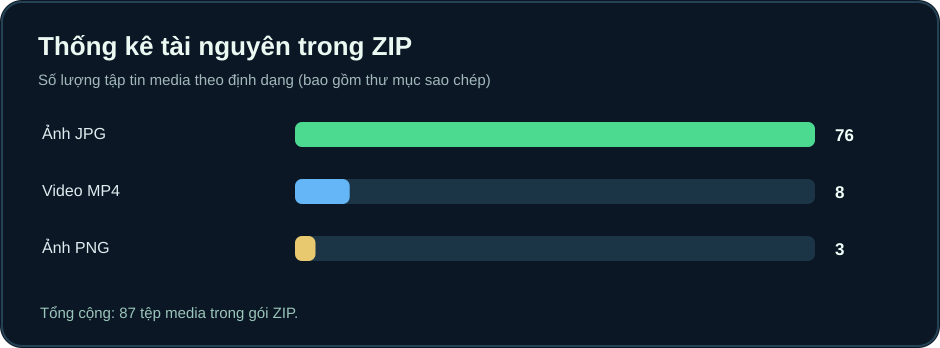
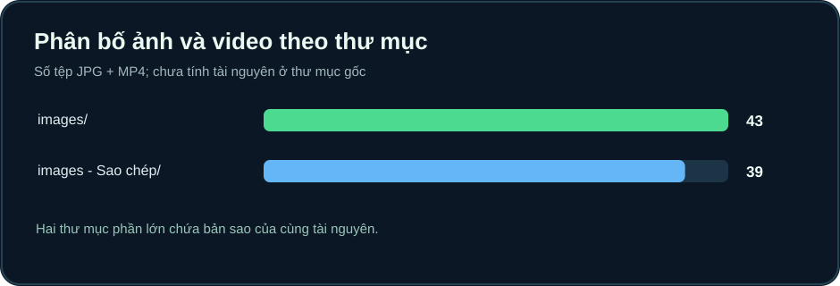
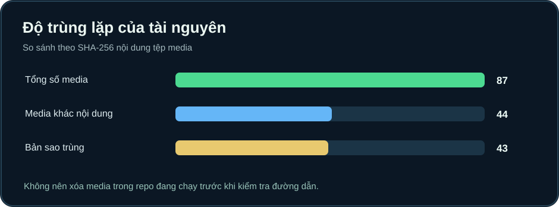
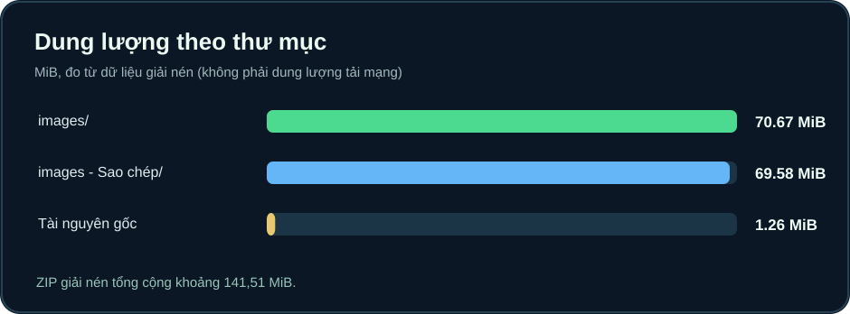
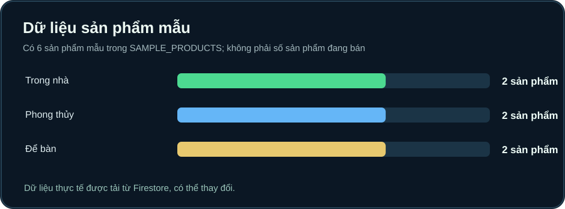
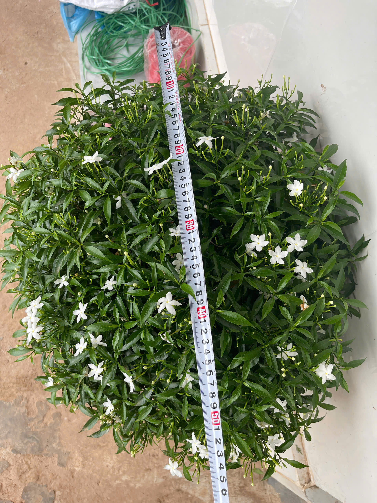

<div align="center">

# 🌿 NHÀ VƯỜN HIỀN HẠNH

### Website giới thiệu, bán cây cảnh và quản lý đơn hàng với Firebase

**“Xanh từ tâm, đẹp từ vườn”**

**HTML5 · CSS3 · JavaScript ES Modules · Firebase Authentication · Cloud Firestore · Firebase Hosting**

[📦 Mã nguồn GitHub](https://github.com/luu246luu-del/NhaVuonHienHanh) · [🪴 Xem sản phẩm](#-chức-năng-dành-cho-khách-hàng) · [📊 Thống kê](#-thống-kê-mã-nguồn-và-tài-nguyên) · [🚀 Cách chạy](#-cài-đặt-và-chạy-thử)

</div>


> **Tình trạng tài liệu:** README này được biên soạn từ mã nguồn `index.html`, cấu hình Firebase và các tài nguyên trong ZIP dự án tại thời điểm kiểm tra ngày 14/10/2026. Các số liệu là thống kê mã nguồn/tài nguyên, **không phải doanh thu, số đơn hàng hay lượt truy cập thực tế**.

## 📖 Giới thiệu dự án

**Nhà Vườn Hiền Hạnh** là website hỗ trợ giới thiệu cây cảnh, tra cứu sản phẩm, chọn cây và combo, quản lý giỏ hàng, gửi đơn đặt hàng, theo dõi đơn của khách và liên hệ nhà vườn. Giao diện hướng đến người dùng điện thoại với các thanh điều hướng, cửa sổ dạng *bottom sheet* và quy trình mua hàng ngắn gọn.

Website cũng chứa **trang quản trị nội bộ** để quản lý danh mục cây, giá, số lượng tồn, thông tin liên hệ, nội dung trang chủ, trạng thái đơn hàng và tải bản sao lưu JSON. Dữ liệu sản phẩm/đơn hàng/cấu hình được đồng bộ với **Cloud Firestore**; đăng nhập quản trị sử dụng **Firebase Authentication**.

Dự án hiện sử dụng **một file giao diện chính `index.html`** tích hợp CSS và JavaScript, không có Backend Java/Python riêng trong ZIP. Các tính năng dữ liệu phụ thuộc vào Firebase, không phải một API máy chủ tự viết.

## ✨ Chức năng dành cho khách hàng

| Nhóm chức năng | Khả năng được xác nhận từ mã nguồn |
|---|---|
| Trang chủ | Logo, banner, slogan, thông báo, nội dung giới thiệu và điều hướng |
| Danh sách cây | Tải danh sách sản phẩm từ Firestore, trình bày theo danh mục |
| Tìm kiếm và lọc | Tìm theo tên/loại cây, lựa chọn danh mục |
| Chi tiết sản phẩm | Hiển thị hình ảnh, video (nếu có), mô tả, giá, tồn kho và lựa chọn combo |
| Giỏ hàng | Thêm/xóa sản phẩm, chỉnh số lượng, tính tổng; lưu ở `localStorage` |
| Đặt hàng | Thu thập tên, số điện thoại, địa chỉ nhận hàng, ghi chú; gửi đơn sang Firestore |
| Theo dõi đơn | Truy vấn đơn hàng theo số điện thoại tài khoản khách hàng trong luồng giao diện |
| Chuyển khoản | Xem QR của **Vietcombank** và **Techcombank**, có thao tác sao chép số tài khoản |
| Liên hệ | Gọi điện và liên hệ Zalo qua thông tin cấu hình cửa hàng |
| Tương tác mobile | Bottom sheet, thao tác đóng bằng vuốt, cửa sổ nổi và thông báo dạng toast |

**Lưu ý về thanh toán:** QR phục vụ hướng dẫn chuyển khoản. Trong mã nguồn được kiểm tra không thấy dịch vụ đối soát giao dịch ngân hàng tự động hoặc cổng thanh toán có webhook xác nhận chuyển tiền. Không nên hiểu màn hình “đặt hàng thành công” là ngân hàng đã xác nhận nhận tiền.

## 🧑‍💼 Chức năng dành cho quản trị viên

| Phân hệ | Tính năng |
|---|---|
| Dashboard | Số lượt truy cập, tổng sản phẩm, tổng đơn, đơn chờ xử lý, tổng giá trị đơn |
| Sản phẩm | Tạo, sửa, xóa cây cảnh; quản lý giá, tồn kho, nhãn, mô tả, ảnh/video |
| Combo | Đặt tên combo, số lượng cây và giá riêng cho các lựa chọn |
| Đơn hàng | Theo dõi và cập nhật trạng thái như đang chuẩn bị, đang giao, hoàn thành |
| Liên hệ | Điều chỉnh số điện thoại và Zalo hiển thị cho khách |
| Trang chủ | Sửa tên cửa hàng, slogan, tiêu đề, nội dung giới thiệu và thông báo |
| Dữ liệu mẫu | Tạo **6 sản phẩm mẫu** trên Firestore khi dữ liệu sản phẩm còn trống |
| Sao lưu | Xuất tệp JSON chứa cấu hình cửa hàng, sản phẩm và đơn hàng |
| Đăng nhập | Firebase Authentication, hỗ trợ đăng xuất và theo dõi trạng thái phiên |

> Các số liệu trong Dashboard lấy từ dữ liệu Firestore (hoặc giá trị hiển thị trước khi tải dữ liệu), không phải số đo được lưu trong README. Tổng giá trị đơn trên giao diện cũng **không nhất thiết bằng doanh thu đã thanh toán**.

## 🛒 Quy trình sử dụng



## 🏗️ Kiến trúc hệ thống



### Vai trò của từng công nghệ

| Công nghệ | Vai trò |
|---|---|
| HTML5 | Cấu trúc giao diện, form đặt hàng, cửa sổ hiển thị |
| CSS3 | Giao diện responsive, thẻ sản phẩm, hiệu ứng, bottom sheet |
| JavaScript ES Modules | Logic giỏ hàng, tìm kiếm, đặt hàng, dashboard, thao tác Firebase |
| Firebase JavaScript SDK 12.2.1 | Kết nối trực tiếp từ Frontend đến các dịch vụ Firebase |
| Firebase Authentication | Đăng nhập/đăng xuất tài khoản quản trị |
| Cloud Firestore | Lưu và đồng bộ sản phẩm, đơn hàng, cài đặt và bộ đếm truy cập |
| Firebase Hosting | Phục vụ website tĩnh, định tuyến về `index.html` |
| localStorage / sessionStorage | Lưu giỏ hàng / hạn chế đếm lặp truy cập trong phiên |

### Các collection / tài liệu được mã nguồn tham chiếu

| Tài nguyên Firestore | Mục đích |
|---|---|
| `products` | Danh sách sản phẩm và thông tin hiển thị |
| `orders` | Đơn hàng của khách |
| `settings/store` | Cấu hình cửa hàng, trang chủ, liên hệ |
| `analytics/global` | Bộ đếm lượt truy cập và dấu thời gian cập nhật |

**Quan trọng:** Các tệp Firestore Security Rules không có trong ZIP đã kiểm tra. Việc chỉ ẩn nút Admin bằng giao diện không thay thế được kiểm soát quyền đọc/ghi tại Firestore. Khi vận hành thực tế, cần thiết lập Rules phân quyền phù hợp cho khách và quản trị viên.

## 📊 Thống kê mã nguồn và tài nguyên

<details open>
<summary><strong>Thống kê chính — từ ZIP và mã nguồn</strong></summary>

| Chỉ tiêu | Giá trị | Ghi chú |
|---|---:|---|
| Dòng trong `index.html` | **9,742** | Tổng dòng HTML/CSS/JS, không phải số dòng JavaScript riêng |
| Sản phẩm mẫu | **6** | Được khai báo trong `SAMPLE_PRODUCTS`; chưa chắc đã thêm vào Firestore |
| Thẻ thống kê trên Dashboard | **5** | Truy cập, sản phẩm, đơn hàng, đơn chờ, giá trị đơn |
| Ảnh JPG trong ZIP | **76** | Bao gồm thư mục sao chép |
| Video MP4 trong ZIP | **8** | Bao gồm thư mục sao chép |
| Ảnh PNG trong ZIP | **3** | Logo và QR ở thư mục gốc |
| Tổng file media | **87** | JPG + PNG + MP4 |
| Media khác nội dung (SHA-256) | **44** | Số tệp media duy nhất xét theo nội dung |
| Bản sao nội dung bị trùng | **43** | Tính bằng tổng media trừ media duy nhất |
| Dung lượng giải nén của ZIP | **141.51 MiB** | Không tính cấu trúc thư mục |
| File HTML trong ZIP | **2** | `index.html` và `index copy.html` |

</details>

### 1. Phân bố định dạng media



### 2. Phân bố tài nguyên giữa hai thư mục



### 3. Kiểm tra nội dung trùng lặp



### 4. Dung lượng ảnh/video theo thư mục



### 5. Dữ liệu sản phẩm mẫu theo danh mục



### Giải thích số liệu

Thư mục `images/` có **39 ảnh JPG, 4 video MP4**, trong khi `images - Sao chép/` có **35 ảnh JPG, 4 video MP4**. Hai thư mục chia sẻ nhiều tệp có nội dung giống hệt, nên gói dự án có độ trùng lặp lớn. **Không xóa thư mục nào trực tiếp trên website đang chạy** trước khi kiểm tra toàn bộ đường dẫn media đang được sử dụng.

Những biểu đồ này **không phải Analytics số người truy cập/đơn hàng**. Muốn báo cáo tăng trưởng kinh doanh cần xuất số liệu đã được phép truy cập từ Firestore rồi tính toán riêng.

## 🌳 Một số sản phẩm và hình ảnh trong dự án

<div align="center">
<table>
<tr>
<td align="center"><br/><strong>Nhóm cây cảnh</strong></td>
<td align="center"><br/><strong>Cây phát tài</strong></td>
<td align="center"><br/><strong>Cây lan ý</strong></td>
</tr>
</table>
</div>

Bộ dữ liệu mẫu gồm: **Cây Trầu Bà Thái**, **Cây Kim Tiền**, **Cây Lưỡi Hổ**, **Cây Ngọc Ngân**, **Sen Đá Xanh** và **Cây Phát Tài**. Đây là dữ liệu được khai báo sẵn để khởi tạo thử, không phải thống kê tồn kho thực tế.

## 📁 Cấu trúc repository

```text
NhaVuonHienHanh/
├── index.html                 # Website chính; CSS + JavaScript tích hợp
├── index copy.html            # Bản HTML khác trong ZIP; không phải trang mặc định
├── banner-nha-vuon.jpg       # Ảnh banner
├── logo.png                   # Logo
├── logo-mo-dau.png.jpg       # Tệp logo bổ sung
├── qr-bank-01.png             # QR chuyển khoản 1
├── qr-bank-02.png             # QR chuyển khoản 2
├── images/                    # Ảnh và video sản phẩm
├── images - Sao chép/         # Bản sao dữ liệu media trong ZIP
├── firebase.json              # Cấu hình Firebase Hosting
├── .firebaserc                # Bí danh Firebase project
├── .gitignore                 # Quy tắc file Git bỏ qua
├── README.md                  # Tài liệu hiện tại
└── docs/
    └── assets/               # Biểu đồ SVG thống kê dự án
```

> Các mục `README.md` và `docs/assets/` được bổ sung bởi gói tài liệu, không phải đã tồn tại sẵn trong ZIP ban đầu.

## 🚀 Cài đặt và chạy thử

### Phương án A — Xem giao diện tĩnh bằng VS Code

1. Tải/clone repository và mở thư mục trong **VS Code**.
2. Mở file `index.html` bằng trình duyệt hoặc extension **Live Server**.
3. Nếu trình duyệt chặn module hoặc một số hành vi file `file://`, hãy dùng server HTTP cục bộ như phương án B.
4. Để sản phẩm/đơn hàng hoạt động, dự án Firebase liên quan phải được cấu hình đúng và Firestore Rules phải cho phép thao tác hợp lệ.

### Phương án B — Chạy HTTP cục bộ bằng Python

```powershell
# Chạy tại thư mục đã clone repository
cd D:\NhaVuonHienHanh
python -m http.server 5500
```

Mở **http://localhost:5500** trên máy tính. Để dừng server, nhấn `Ctrl+C` trong Terminal.

### Clone mã nguồn từ GitHub

```powershell
git clone https://github.com/luu246luu-del/NhaVuonHienHanh.git
cd NhaVuonHienHanh
```

### Phương án C — Triển khai Firebase Hosting

Yêu cầu: Node.js, Firebase CLI, đăng nhập tài khoản có quyền với Firebase project và cấu hình dự án thích hợp.

```powershell
npm install -g firebase-tools
firebase login
firebase use nha-vuon-hien-hanh
firebase deploy --only hosting
```

Trong `firebase.json`, `hosting.public` đang là `"."`, và các URL không khớp file tĩnh được rewrite về `/index.html`. Nếu đổi cấu trúc thư mục, cần sửa `hosting.public` tương ứng. **Push GitHub không tự động deploy Firebase**, trừ khi đã thiết lập CI/CD riêng.

> Không có `package.json` trong ZIP. Website dùng Firebase SDK nhập trực tiếp từ CDN, vì vậy không cần `npm install` để chạy Frontend tĩnh. Lệnh `npm install -g` bên trên chỉ nhằm cài Firebase CLI phục vụ deploy.

## 🛠️ Hướng dẫn chỉnh sửa website

### Thay tên cửa hàng, slogan và banner

Trên Admin, các trường tên cửa hàng, slogan, tiêu đề giới thiệu, mô tả và thông báo hỗ trợ cập nhật nội dung trang chủ qua Firestore. Banner/logo lưu bằng file tĩnh có thể chỉnh qua file và cập nhật mã nguồn, tùy cách tham chiếu trong HTML.

### Thêm hoặc cập nhật cây cảnh

1. Đăng nhập bằng tài khoản quản trị Firebase hợp lệ.
2. Vào tab **Sản phẩm** → **Thêm sản phẩm**.
3. Nhập tên, giá bán, tồn kho, danh mục, mô tả; thêm đường dẫn ảnh/video nếu cần.
4. Có thể thêm lựa chọn **combo** với tên, số lượng và giá.
5. Nhấn **Lưu sản phẩm lên Firebase** và kiểm tra danh sách khách hàng.

Mã nguồn hiện thao tác với các **đường dẫn media**; không tìm thấy API Firebase Storage `uploadBytes` trong `index.html`. Việc chép ảnh vào `images/` không tự tạo sản phẩm mới trong Firestore.

### Theo dõi đơn hàng

Khách điền thông tin rồi gửi đơn; Admin mở tab **Đơn hàng** để xem và cập nhật trạng thái. Khách có giao diện **Đơn của tôi** để kiểm tra theo thông tin tài khoản trong luồng ứng dụng. Cần kiểm thử và thiết lập phân quyền dữ liệu theo số điện thoại trong Firestore Rules trước khi vận hành công khai.

### Sao lưu dữ liệu

Trong tab **Hệ thống**, chức năng **Tải bản sao lưu JSON** xuất cấu hình/sản phẩm/đơn hàng hiện có trong trạng thái ứng dụng. Tệp sao lưu có thể bao gồm **thông tin khách hàng**, vì thế không đưa file JSON sao lưu đơn hàng lên repository công khai.

## 🔐 Lưu ý bảo mật và dữ liệu

- Firebase Web API key trong mã Frontend không thay thế việc giới hạn API, cấu hình đúng domain và **Firestore Security Rules**. Không công bố email/mật khẩu quản trị hay tài khoản đăng nhập.
- QR chuyển khoản ngân hàng và hình ảnh sản phẩm đang thuộc repository Public. Hãy bảo đảm chủ dự án có quyền công khai chúng.
- Dữ liệu khách hàng (tên, số điện thoại, địa chỉ, lịch sử đơn hàng) cần được bảo vệ ở tầng Firestore; không đưa file backup JSON chứa thông tin cá nhân lên GitHub.
- Bộ đếm truy cập tăng theo phiên ở trình duyệt và thao tác Firestore; đây không phải cơ chế analytics kiểm chứng người dùng duy nhất hoặc chống bot hoàn chỉnh.
- Trước khi ra mắt thực tế, thử đầy đủ quyền đọc/ghi của vai trò khách và Admin trong môi trường staging, khả năng xử lý lỗi kết nối và luồng xác nhận thanh toán.

## 🧪 Kiểm tra kỹ thuật và phạm vi xác minh

| Hạng mục | Kết quả |
|---|---|
| Đọc mã `index.html` và cấu hình Firebase | Đã thực hiện |
| Thống kê tệp JPG/PNG/MP4 trong ZIP | Đã thực hiện |
| So sánh bản sao media theo SHA-256 | Đã thực hiện |
| Kiểm tra cú pháp JavaScript module bằng Node.js `--check` | **Hợp lệ** |
| Chạy thử đăng nhập Firebase thực tế | Chưa thực hiện |
| Thử gửi đơn và đối chiếu dữ liệu Firestore thật | Chưa thực hiện |
| Benchmark hiệu năng mobile / Lighthouse | Chưa thực hiện |
| Kiểm tra thanh toán ngân hàng thực tế | Chưa thực hiện |

Các chức năng nêu trong README được đối chiếu từ mã nguồn, **không có nghĩa đã kiểm thử tích hợp end-to-end với Firebase đang hoạt động**.

## 🗺️ Định hướng nâng cấp (đề xuất, chưa triển khai)

1. Tách `index.html` thành các module CSS/JavaScript để thuận tiện bảo trì.
2. Thêm kiểm thử E2E cho giỏ hàng, tạo đơn, trạng thái và giao diện mobile.
3. Chuẩn hóa quy trình quản lý ảnh; giảm file trùng và tối ưu kích thước JPEG/video.
4. Bổ sung tổng hợp số liệu quản trị đã phân quyền, xuất báo cáo an toàn.
5. Xem xét tích hợp thanh toán có webhook xác nhận khi có nhu cầu nghiệp vụ.
6. Thiết lập CI/CD để triển khai Firebase khi merge mã nguồn đã kiểm thử.

## 📄 Ghi chú nguồn số liệu

- **Nguồn mã nguồn:** `NhaVuonHienHanh-main (1).zip` và repository GitHub trong đường dẫn ở đầu tài liệu.
- **Thời điểm thống kê:** 14/10/2026.
- **Phương pháp:** đếm tệp ZIP theo phần mở rộng, cộng dung lượng giải nén, đối chiếu SHA-256 tài nguyên, đọc logic của `index.html` và xác thực cú pháp JS.
- **Chưa xác minh:** số sản phẩm thực tế trong Firestore, người dùng thật, lượng đặt hàng, số lượt truy cập thật, doanh thu đã thanh toán và tốc độ tải website ngoài Internet.

---

<div align="center">

**🌱 NHÀ VƯỜN HIỀN HẠNH — Xanh từ tâm, đẹp từ vườn**

*Mã nguồn & tài liệu kỹ thuật trong repository này dành cho việc quản lý, giới thiệu và vận hành website nhà vườn.*

</div>
